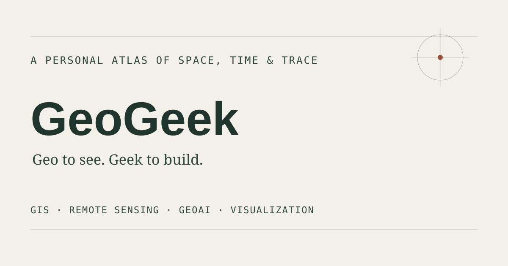

# GeoGeek

**Geo to see. Geek to build.**

**AI Native · Geospatial Engineering · Open Science**

[**Enter GeoGeek ↗**](https://geogeeklab.github.io/) · [Field Notes](https://geogeeklab.github.io/field-notes.html) · [Lab](https://geogeeklab.github.io/lab.html) · [Atlas](https://geogeeklab.github.io/atlas.html) · [Elsewhere](https://geogeeklab.github.io/elsewhere.html)

[](https://geogeeklab.github.io/)

Here's the thing: Two maps can show the same place and tell you different things. Change the **source, extent, scale, time, or method**, and a new pattern may appear.

So, how do we make sense of what we see? By asking better geographic questions — and building ways to explore them.

**GeoGeek** is a research-engineering practice for **seeing geographically and building spatially**. It brings together field writing, interactive geographic instruments, and independent engineering projects. The aim is simple: make the choices behind a spatial representation easier to see, explore, and understand.

## Explore the field

Where would you like to start? Follow an idea, try an instrument, or browse the archive from a different angle.

| Entry | What you will find |
| --- | --- |
| [**Origin**](https://geogeeklab.github.io/origin/) | Follow the questions behind GeoGeek, from the cosmos to the act of observation. [中文](https://geogeeklab.github.io/origin/cn/) |
| [**Coordinates**](https://geogeeklab.github.io/#now) | Discover the three coordinates of the practice: AI Native as method, Geospatial Engineering as domain, and Open Science as ethos. |
| [**Commons**](https://geogeeklab.github.io/#commons) | Explore a shared geographic field of positions, relations, and observations. |
| [**Field Notes**](https://geogeeklab.github.io/field-notes.html) | Read essays and working notes on GIS, remote sensing, GeoAI, scale, and research practice. |
| [**Lab**](https://geogeeklab.github.io/lab.html) | Try interactive instruments that reveal how geographic systems and representations work. |
| [**Atlas**](https://geogeeklab.github.io/atlas.html) | Explore the archive by field, time, type, topic, trace, and geographic relations. |
| [**Elsewhere**](https://geogeeklab.github.io/elsewhere.html) | Find photography, books, sound, and creative work beyond the main geographic archive. |

### Coordinates, not credentials

Four values guide the practice:

**Open** to connect · **Taste** to discern · **Respect** to trust · **Respond** to answer.

The site also follows an *information scale*:

```text
SITE → POSITION → COLLECTION → RECORD → DETAIL
```

Think of it as a path into the work. Start with the whole site, find a collection, open a record, and move into its details. Each step gives you a closer view of the ideas and tools behind it.

Here, *scale* describes **the depth of reading and interaction**. Cartographic scale describes something different: the relationship between distances on a map and distances on the ground.

## Lab — see what changes when you change something

Want to understand a geographic system? Try changing one part of it.

The Lab currently brings together **13 interactive instruments** in three groups. Each instrument has two complementary ways in:

- **Record:** Read the context, sources, assumptions, conditions, and limits.
- **Interactive workspace:** Change a variable and observe what happens.

Together, they connect the explanation to the experience.

### Studies / representation and abstraction

How does a representation change the world we think we're seeing? These studies let you examine the steps between an image, a model, and a geographic view.

| Instrument | What it makes visible |
| --- | --- |
| [**Image → Trace**](https://geogeeklab.github.io/records/lab-l11.html) | Watch a raster image become contours, regions, and traces. |
| [**World as Relation**](https://geogeeklab.github.io/records/lab-l12.html) | Explore how projection choices change geographic relations and distortion. |

### Observatory / changing fields

The Earth keeps changing. So do the ways we observe it. These instruments help you explore movement, time, measurements, and their interpretation.

| Instrument | What it makes visible |
| --- | --- |
| [**Orbital Commons**](https://geogeeklab.github.io/records/lab-l04.html) | Connect satellite catalogs, propagated orbits, and ground relations. |
| [**Earth in Change**](https://geogeeklab.github.io/records/lab-l05.html) | Examine Earth observation as a time-dependent image rather than a fixed basemap. |
| [**Geographic Flow Laboratory**](https://geogeeklab.github.io/records/lab-l06.html) | Compare vector fields, origin–destination flows, trajectories, and releases. |
| [**Earth Pulse**](https://geogeeklab.github.io/records/lab-l10.html) | Explore earthquakes by magnitude, depth, recency, and spatial aggregation. The instrument describes observed activity rather than forecasting hazards. |
| [**Water as Spectrum**](https://geogeeklab.github.io/records/lab-l13.html) | Follow the path from water optics and atmospheric effects to sensor signals and inversion assumptions. |

### Play / spatial reasoning

Sometimes the best way to understand a spatial idea is to test your own intuition. Make a choice, see the result, and try again.

| Instrument | What you change or test |
| --- | --- |
| [**Locate**](https://geogeeklab.github.io/records/lab-l07.html) | Estimate a location, then inspect distance and bearing error. |
| [**Zone**](https://geogeeklab.github.io/records/lab-l08.html) | Recognize a country through shape, position, and neighbors. |
| [**Trace**](https://geogeeklab.github.io/records/lab-l09.html) | Navigate a topological path through shared land borders. |
| [**Project**](https://geogeeklab.github.io/records/lab-l14.html) | Predict how a projection will change familiar geography, then inspect the result. |
| [**Light**](https://geogeeklab.github.io/records/lab-l15.html) | Remove light-path mechanisms and observe the remaining signal. |
| [**Swath**](https://geogeeklab.github.io/records/lab-l16.html) | Change altitude, field of view, and detector samples to explore coverage and sampling tradeoffs. |

```text
LAB COLLECTION
    │
    ├── RECORD ────────→ context / source / conditions / limits
    │
    └── INSTRUMENT ────→ change a variable / observe the consequence
```

The source archive also retains **three earlier conceptual Lab studies**. They remain part of the collection's history and are separate from the 13 interactive instruments shown in the current Lab.

**[Open the Lab ↗](https://geogeeklab.github.io/lab.html)**

## Engineering builds

Some questions lead to essays. Others lead to tools.

GeoGeek connects to independent engineering and research projects, each developed in its own repository. They extend the same curiosity into geospatial diagnostics, data discovery, research workflows, and software engineering.

| Project | Focus |
| --- | --- |
| [**GeoDebug**](https://github.com/GeoGeekLab/geodebug) | Geospatial debugging and data diagnostics |
| [**STAC Scout**](https://github.com/GeoGeekLab/stac-scout) | Spatiotemporal asset discovery |
| [**Nature Reviewer Skills**](https://github.com/GeoGeekLab/nature-reviewer-skills) | Research review workflows |
| [**IPCC WGI Scientific Plotting**](https://github.com/GeoGeekLab/ipcc-wg1-scientific-plotting-skill) | Scientific plotting |
| [**engineering-quality**](https://github.com/GeoGeekLab/engineering-quality) | Software engineering quality |
| [**modern-software-codex-skills**](https://github.com/GeoGeekLab/modern-software-codex-skills) | Agent-assisted engineering workflows |
| [**awesome-tech-feeds**](https://github.com/GeoGeekLab/awesome-tech-feeds) | Curated technical knowledge feeds |
| [**personal-learning-map**](https://github.com/GeoGeekLab/personal-learning-map) | Learning systems and knowledge mapping |

Discover more at [**GeoGeekLab on GitHub ↗**](https://github.com/GeoGeekLab).

## Inside this repository

Curious how the site works? This repository contains the **GeoGeek website**, its content sources, geographic instrument runtimes, and the static-site delivery pipeline.

```text
content/field-notes/   Canonical Field Notes sources
site/                  Website pages, styles, archive data, instruments
site/records/          Lab and Elsewhere record pages
templates/             Templates for generated pages
backend/               Supporting backend code
scripts/               Build, data preparation, validation, and QA
tests/                 Node and browser tests
docs/                  Technical decisions and instrument documentation
.github/workflows/     Quality checks and GitHub Pages deployment
dist/                  Generated deployment output (not source-controlled)
```

**Edit the sources, not `dist/`.** The build also generates `site/archive-content.js` and article assets for local previews. The source files remain the canonical place to make changes.

### Build and preview

The deployment workflow uses **Node.js 24**.

```bash
npm run build
npm run preview
```

Run checks after changes to content, interaction, or layout:

```bash
npm run qa
npm run qa:links
npm run qa:browser
```

Browser checks use Playwright tooling and installed browsers. In CI, full release verification also prepares external data snapshots and Lab imagery. These generated assets may be absent from a plain local checkout.

### Delivery

```text
content/ + site/ + templates/
             │
             ▼
       npm run build
             │
             ▼
      validated dist/
             │
             ▼
       GitHub Actions
             │
             ▼
        GitHub Pages
```

Pushes to `main` trigger the [Pages workflow](.github/workflows/pages.yml). Pull requests run the [quality workflow](.github/workflows/quality.yml).

For implementation details, read [REPOSITORY.md](REPOSITORY.md) and [STATIC_DELIVERY_ARCHITECTURE.md](STATIC_DELIVERY_ARCHITECTURE.md).

## Sources, uncertainty, and reuse

Every geographic instrument begins with choices about observations, catalogs, imagery, or geometry. When these come from third parties, their availability and freshness can change.

GeoGeek makes observation conditions and limits part of the experience. This helps you understand where a representation comes from, what it can show, and how to interpret it.

Third-party attributions and license terms are documented in [site/THIRD_PARTY_LICENSES.md](site/THIRD_PARTY_LICENSES.md). Each external dataset and asset retains its own terms of use within the site's **Open Science** practice.

---

**Geo to see. Geek to build.**  
[Website](https://geogeeklab.github.io/) · [GitHub](https://github.com/GeoGeekLab) · [Report an issue](https://github.com/GeoGeekLab/GeoGeekLab.github.io/issues)